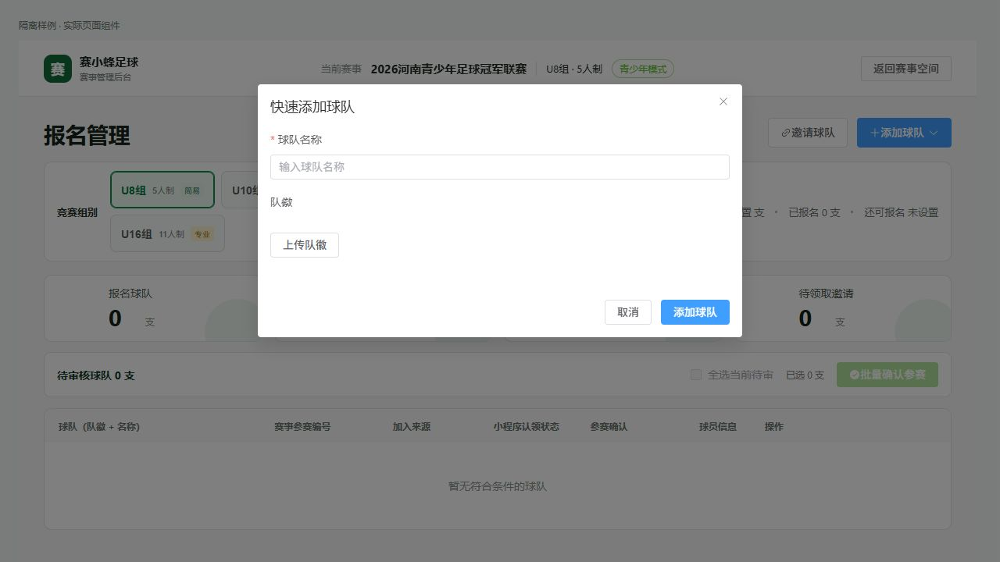
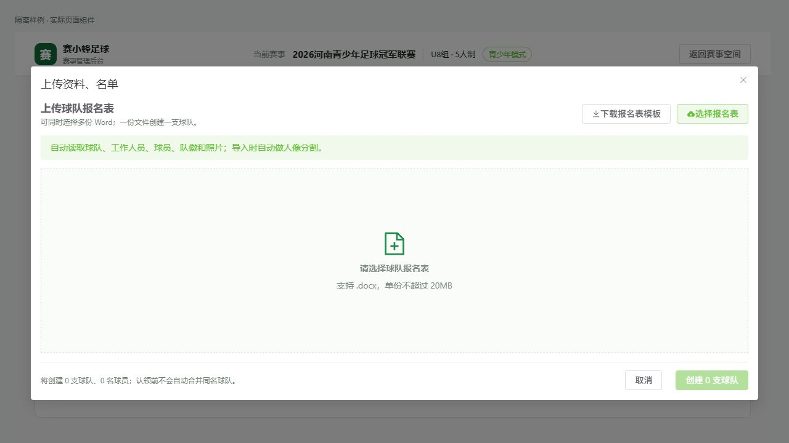
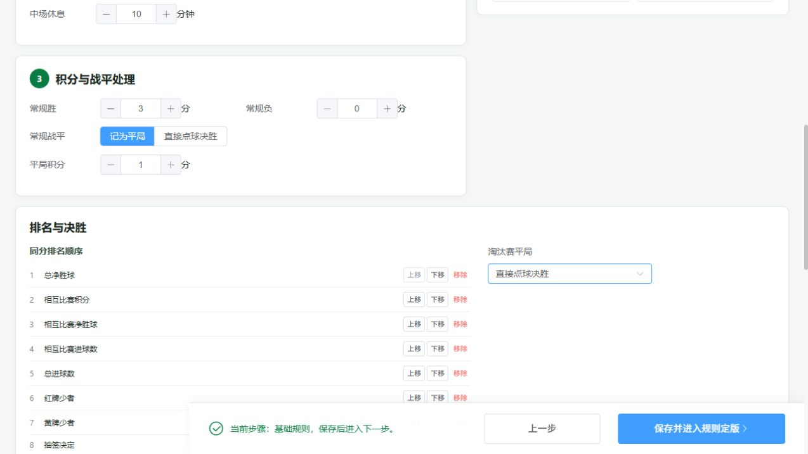

# 排名决胜设置与球队入口拆分

## 排名与决胜

普通版基础规则原只显示固定摘要，专业配置同分顺序也只是固定文本；淘汰赛平局选项原仅专业配置可见。新增共用DivisionOutcomeRules，公开现有rankingTieBreakers和knockoutTieBreak字段：同分比较项可上移、下移、移除、重新添加；积分始终优先，抽签固定最后并由组委会线下确认。仅淘汰赛不显示积分同分项，联赛不显示淘汰平局项。淘汰平局可选直接点球或加时后点球。

定版摘要、只读规则、规程导出与积分榜各组的顺序说明取实际字段，移除统一写死的同分说明。现有字段已由授权更新与规则快照保留；不新增客户端统计算法，实际排序仍调用现有dataCenter/shared/standings.cjs。隔离样例确认先相互战绩与先净胜球产生不同且正确的顺序；不宣称系统自动执行抽签。

## 球队入口

原manual/upload两入口进入一个可相互切换的弹窗。现在快速添加是独立手动基础表单，上传资料名单是独立Word解析导入弹窗；分别使用显示状态及关闭、成功回调。保留原名额检查、权限、导入校验、身份与名单审核，不因手工添加取得正式参赛资格。

4份SFC编译及8组隔离排名验证通过。三个入口开关独立验证，未创建真实球队或更改真实规则。组别删除不重建修复9860c8c同时保留。

仅发布preview；正式/admin等待用户对当前修改的明确上线授权。没有修改或发布小程序及云函数。

实际组件隔离核对完成：总净胜球上移到首位；淘汰平局改直接点球；保存进入定版摘要后仍显示新顺序与点球方式。导出章节检查同样读取新顺序与处理方式，联赛不写淘汰条款。快速添加仅球队名称/队徽，上传入口仅模板下载/文件解析，两弹窗独立打开关闭。隔离挂载直接复用正式组件并阻断真实webLoginApi请求；未绕过正式登录或改动权限。

演示数据仓库本体进一步验证：初次生成→删除空组别→刷新→快照恢复，组别仍保持删除；原本已存在的建议组别也标记消费，避免零新增时状态未落地。

最终测试版构建源码23283236；/preview/admin/共377个文件，逐一HTTP200且SHA256与发布包完全一致。检查时间2026-10-17 17:00（Asia/Shanghai）。正式版本本次未部署。
