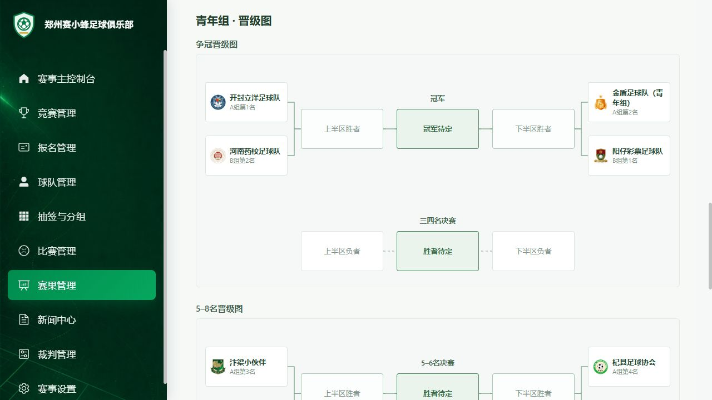

# 积分排名晋级图正式发布

- 授权：用户明确要求将本次晋级图合并正式版。
- 正式与测试构建源码：79fd0715d4bc3b2bb26ed2a24ced82566e97df97。
- 正式目标：/admin/；测试同步：/preview/admin/，分别设置base构建。
- 发布内容：按组别积分榜后展示通用晋级图；单队节点、原小组名次、左右汇入冠军位，三四名及其他排位在下方；旧bracket链接兼容积分排名。
- 两端均成功完整上传376文件，入口与入口依赖及赛果页JS/CSS均HTTP200且SHA256一致。
- 正式页只读截图核对完成；未写入真实比赛，未部署云函数。
- 未新增或运行测试套件；已完成构建、资源路径、摘要回读和实际页面检查。

## 资源摘要

- 正式 index.html SHA256 58c93d02e6a91392d86659413da61d4dfc5be8c004865ffb84b0b4644ee5cd1e
- 正式 TournamentResultCenter-CpcUS1AP.js SHA256 e7254b1e12e57179a074ec554bb0d691010c4086f3980b5bd5124b37080cf6d3
- 正式 TournamentResultCenter-TE-iax07.css SHA256 1ac1fd088da62d8d29b10d1362f3500b5b773bbadfce09c759df99922bef9d0a
- 测试 index.html SHA256 b3160bec920a19fedda14385679e1913cd7f08095b7799e0260970717b99c8dd
- 测试 TournamentResultCenter-sxW4raoT.js SHA256 891d93505d0c96636593b8075aa4be3ac4049da065164f538fbc33d22e030a14
- 测试 TournamentResultCenter-BBcbWdUW.css SHA256 10c5bda4fba0ddd2d6b2dcff9b76d407750a71bce8d0d4f8d3602e21fd75e524

## 正式页面截图

